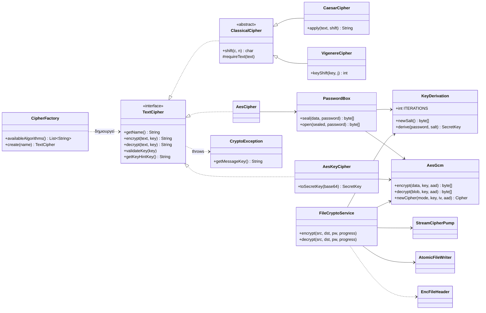
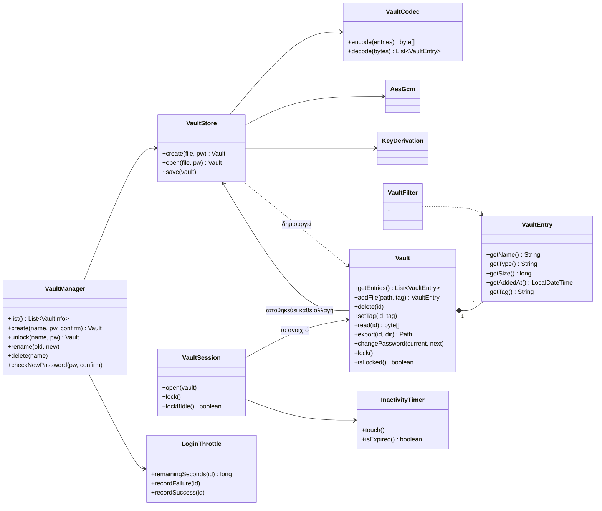
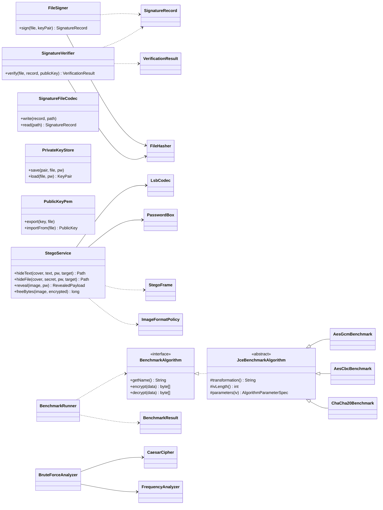
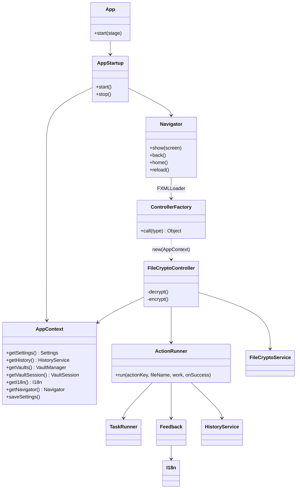
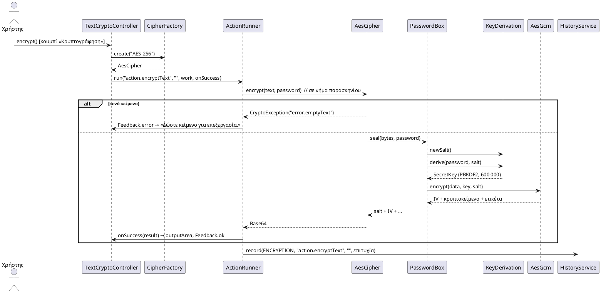
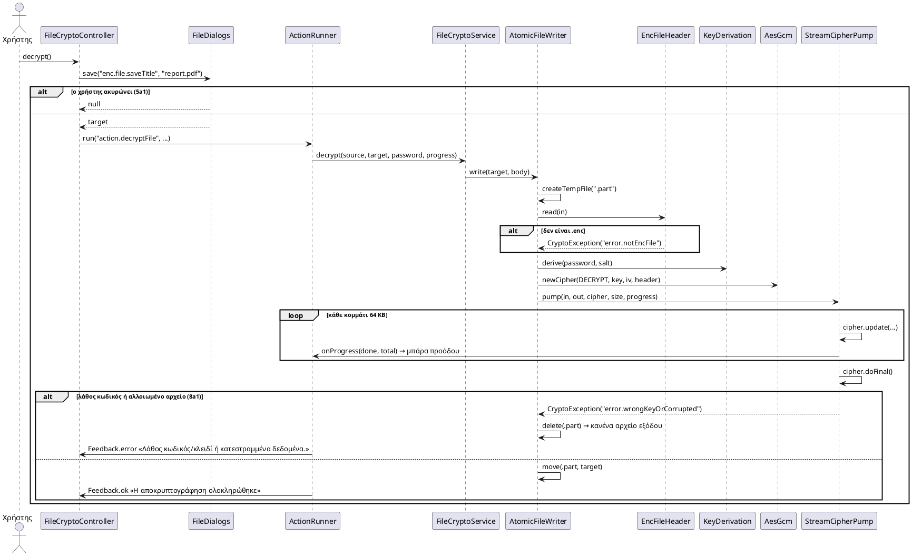
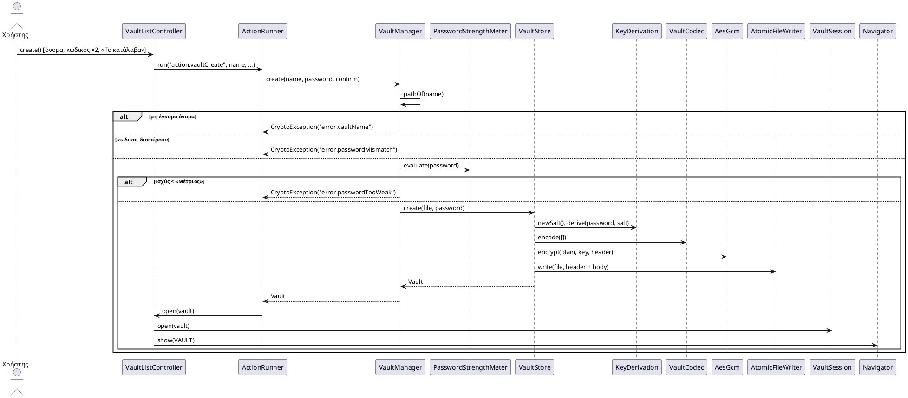
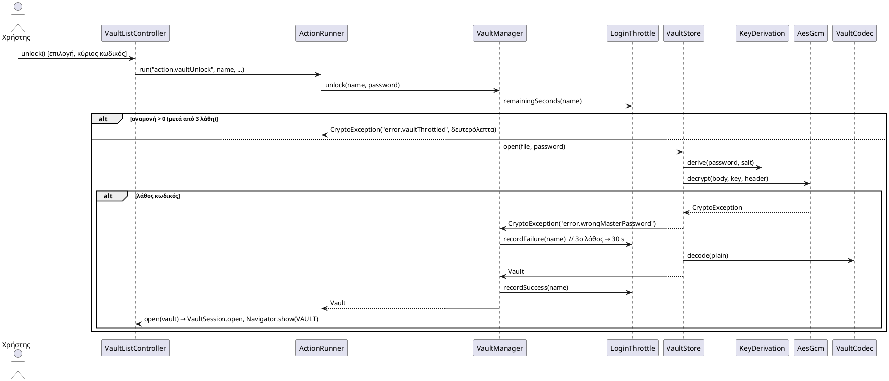
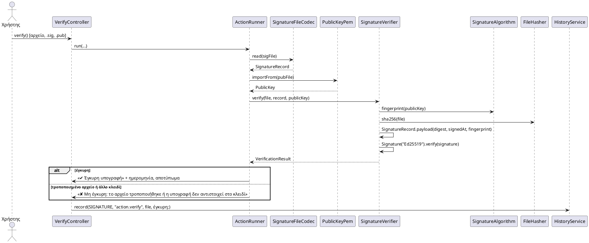
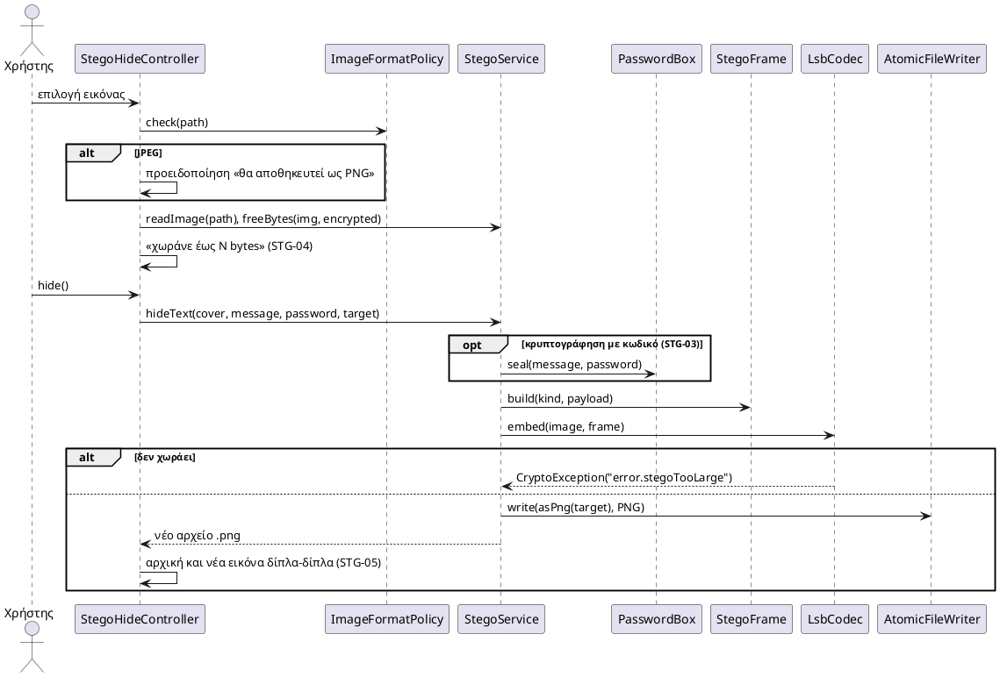

# Σχεδίαση της εφαρμογής αναφοράς — Ομάδα 12

Το κείμενο αυτό εξηγεί **πώς** είναι φτιαγμένη η εφαρμογή αναφοράς και **γιατί**, ώστε η ομάδα να γράψει τη δική
της με τις ίδιες ιδέες (και να μπορεί να τις υπερασπιστεί στην παρουσίαση). Οδηγίες εγκατάστασης και ο πλήρης
πίνακας «λειτουργία → κλάση → test» είναι στο [README.md](README.md).

Περιεχόμενα: [α) Αρχιτεκτονική](#α-η-αρχιτεκτονική-με-απλά-λόγια) ·
[β) Σχεδιαστικές επιλογές](#β-γιατί-κάθε-σχεδιαστική-επιλογή) ·
[γ) Διάγραμμα κλάσεων](#γ-διάγραμμα-κλάσεων) ·
[δ) Διαγράμματα ακολουθίας και test cases](#δ-προτάσεις-για-το-παραδοτέο-2) ·
[Μετρικές](#μετρικές-ποιότητας) ·
[ε) Αποφάσεις](#ε-αποφάσεις) ·
[στ) Τι δεν υλοποιήθηκε πλήρως](#στ-τι-δεν-υλοποιήθηκε-πλήρως)

---

## α) Η αρχιτεκτονική με απλά λόγια

Η εφαρμογή χωρίζεται σε τρία στρώματα, όπως ζητά το MVC:

```
  ┌────────────────────────────────────────────────────────────────────┐
  │ VIEW        FXML (23 αρχεία) + CSS (φωτεινό/σκοτεινό) + κείμενα      │  «πώς φαίνεται»
  │             σε messages_el / messages_en.properties                 │
  ├────────────────────────────────────────────────────────────────────┤
  │ CONTROLLER  ένας μικρός controller ανά FXML (18 + 1 βοηθητικός)     │  «τι γίνεται όταν πατάω»
  │             + υποδομή: Navigator, ActionRunner, Feedback, Dialogs…  │
  ├────────────────────────────────────────────────────────────────────┤
  │ MODEL       καθαρή Java, ΧΩΡΙΣ JavaFX: κρυπτογραφία, θησαυροφυλάκιο, │  «η δουλειά»
  │             υπογραφές, στεγανογραφία, εργαστήριο, ιστορικό, ρυθμίσεις│  (όλο με JUnit tests)
  └────────────────────────────────────────────────────────────────────┘
```

**Μια ενέργεια από την αρχή ως το τέλος** (π.χ. «Αποκρυπτογράφηση αρχείου»):

1. Ο χρήστης πατά το κουμπί. Το FXML καλεί τη μέθοδο `decrypt()` του `FileCryptoController`.
2. Ο controller μαζεύει ό,τι έδωσε ο χρήστης (αρχείο, κωδικό), ζητά πού θα αποθηκευτεί το αποτέλεσμα
   και δίνει τη δουλειά στον `ActionRunner`.
3. Ο `ActionRunner` κλειδώνει τα κουμπιά και τρέχει τη δουλειά σε **νήμα παρασκηνίου** (`TaskRunner`), ώστε η οθόνη να
   μην «παγώνει». Δένει επίσης τη μπάρα προόδου και το «Ακύρωση».
4. Το μοντέλο (`FileCryptoService`) κάνει την αποκρυπτογράφηση. Αν κάτι πάει στραβά, πετά `CryptoException` με
   **κλειδί μηνύματος** (π.χ. `error.wrongKeyOrCorrupted`), όχι με έτοιμο κείμενο.
5. Ο `ActionRunner` γυρίζει στο νήμα της διεπαφής και δείχνει πράσινο ή κόκκινο μήνυμα στη γλώσσα του χρήστη
   (`Feedback` + `I18n`). Γράφει και στο ιστορικό **μόνο** ενέργεια, όνομα αρχείου και αποτέλεσμα.

**Πλοήγηση.** Υπάρχει ένα παράθυρο. Ο `Navigator` αλλάζει το περιεχόμενο στο κέντρο του και κρατά πάντα την ίδια μπάρα
πάνω: «Πίσω», «Αρχική», τίτλο, «?». Οι 8 οθόνες (UI-01 … UI-08) είναι στο enum `Screen`. Οι μεγάλες ενότητες έχουν
καρτέλες (`TabPane` με `fx:include`), ώστε κάθε βασική ενέργεια να είναι το πολύ 3 κλικ από την αρχική (NFR-07).

**Κοινές υπηρεσίες.** Το `AppContext` φτιάχνεται μία φορά στην εκκίνηση και κρατά ρυθμίσεις, ιστορικό, θησαυροφυλάκια,
κείμενα, πλοήγηση. Το `ControllerFactory` το δίνει στον κατασκευαστή κάθε controller (απλό dependency injection,
χωρίς βιβλιοθήκη). Έτσι οι controllers δεν φτιάχνουν μόνοι τους υπηρεσίες και δεν υπάρχουν «καθολικές» μεταβλητές.

**Αποθήκευση.** Χωρίς βάση δεδομένων (NFR-12): ρυθμίσεις σε `.properties`, ιστορικό σε απλό αρχείο κειμένου,
κάθε θησαυροφυλάκιο σε ένα κρυπτογραφημένο αρχείο. Όλα στο `~/.omada12-crypto/`.

**Γλώσσα.** Κανένα κείμενο διεπαφής μέσα στον κώδικα (NFR-09): τα FXML γράφουν `%κλειδί`, ο κώδικας ζητά
`i18n.text("κλειδί")`, το μοντέλο στέλνει κλειδιά. Η αλλαγή γλώσσας ξαναφορτώνει την οθόνη με το άλλο bundle.
Το `BundleConsistencyTest` ελέγχει ότι ΕΛ και EN έχουν ακριβώς τα ίδια κλειδιά και ότι υπάρχει κάθε κλειδί που
χρησιμοποιείται.

---

## β) Γιατί κάθε σχεδιαστική επιλογή

### Πρότυπα σχεδίασης

| Πρότυπο | Πού | Γιατί |
|---|---|---|
| **MVC** | `model` / `controller` / FXML+CSS | Το μοντέλο ελέγχεται με JUnit χωρίς οθόνη· η εμφάνιση αλλάζει χωρίς να αγγίξουμε τη λογική. |
| **Strategy** | `TextCipher` (Caesar, Vigenère, AES με κωδικό, AES με κλειδί), `BenchmarkAlgorithm` (GCM, CBC, ChaCha20) | Ο controller μιλά μόνο με το interface. Νέος αλγόριθμος = νέα κλάση (NFR-11). |
| **Factory** | `CipherFactory`, `BenchmarkCatalog` | Η διεπαφή ζητά αλγόριθμο με το όνομα, χωρίς να ξέρει την κλάση. Ένα σημείο για να «δηλωθεί» νέος αλγόριθμος. |
| **Template Method** | `ClassicalCipher` (κοινή μετατόπιση γράμματος), `JceBenchmarkAlgorithm` (κοινή κρυπτογράφηση με IV, οι υποκλάσεις δίνουν μόνο παραμέτρους) | Ο κοινός κώδικας γράφεται μία φορά (λιγότερες γραμμές, DIT = 1–2, NOCC = 2–3). |
| **Facade / Service** | `FileCryptoService`, `StegoService`, `VaultManager`, `HistoryService` | Ο controller κάνει μία κλήση· οι λεπτομέρειες (κεφαλίδες, salt, IV, LSB) μένουν κρυμμένες. |
| **Observer** | `ProgressListener` (μοντέλο → μπάρα προόδου), JavaFX properties/listeners (π.χ. ένδειξη ισχύος καθώς πληκτρολογείς) | Το μοντέλο αναφέρει πρόοδο χωρίς να ξέρει τι είναι η μπάρα. |
| **Dependency Injection** (απλή) | `ControllerFactory` + `AppContext` | Οι controllers παίρνουν τις υπηρεσίες στον κατασκευαστή (μικρό CBO, εύκολη αντικατάσταση). |
| **Session** | `VaultSession` | Ένα μόνο σημείο ξέρει ποιο θησαυροφυλάκιο είναι ανοιχτό· το κλείδωμα (κουμπί, αδράνεια, έξοδος) γίνεται εκεί. |

### Αρχές που ακολουθήθηκαν

- **Μία ευθύνη ανά κλάση.** Π.χ. η στεγανογραφία είναι 7 μικρές κλάσεις: `LsbCodec` (μόνο bits), `StegoFrame`
  (μόνο κεφαλίδα), `PayloadKind`, `HiddenFile`, `RevealedPayload`, `ImageFormatPolicy`, `StegoService` (συντονισμός).
  Το `VaultController` χωρίστηκε σε controller (πίνακας + φίλτρα) και `VaultEntryActions` (ενέργειες σε αρχεία).
- **Ο κοινός κώδικας μία φορά.** `ActionRunner` (κάθε ενέργεια: κλείδωμα κουμπιών, παρασκήνιο, μήνυμα, ιστορικό),
  `FileSelection` (πεδίο αρχείου με drag & drop), `PasswordBox` (κλείδωμα bytes με κωδικό για κείμενο, στεγανογραφία
  και ιδιωτικά κλειδιά), `AtomicFileWriter` (κάθε εγγραφή αρχείου).
- **Το μοντέλο δεν ξέρει JavaFX.** Γι' αυτό τρέχει σε tests χωρίς οθόνη και θα μπορούσε να έχει άλλη διεπαφή.
- **Σφάλματα με κλειδιά μηνυμάτων.** Μία εξαίρεση (`CryptoException`) με κλειδί bundle + παραμέτρους. Ο χρήστης
  βλέπει πάντα κατανοητό μήνυμα στη γλώσσα του (APP-04) και τα tests ελέγχουν το κλειδί, όχι το κείμενο.

### Αλγόριθμοι

| Τι | Επιλογή | Γιατί |
|---|---|---|
| Κρυπτογράφηση | **AES-256-GCM**, τυχαίο IV 12 bytes μπροστά στο κρυπτοκείμενο, ετικέτα 128 bit | Το GCM ελέγχει και την ακεραιότητα: με λάθος κωδικό ή αλλοιωμένο αρχείο η αποκρυπτογράφηση **αποτυγχάνει** αντί να βγάλει σκουπίδια (ENC-05). Νέο IV κάθε φορά (NFR-01): το ίδιο κείμενο δίνει κάθε φορά άλλο κρυπτογράφημα. |
| Κλειδί από κωδικό | **PBKDF2-HMAC-SHA256**, 600.000 επαναλήψεις, salt 16 bytes ανά αρχείο | Σύσταση OWASP (NFR-02). Οι πολλές επαναλήψεις κάνουν κάθε δοκιμή κωδικού αργή (~0,2 s), άρα το brute force γίνεται πρακτικά αδύνατο. Το salt κάνει τον ίδιο κωδικό να δίνει άλλο κλειδί σε κάθε αρχείο. |
| AAD | Η κεφαλίδα του αρχείου (μαγικός αριθμός, έκδοση, salt) περνά ως Additional Authenticated Data | Αν κάποιος αλλάξει την κεφαλίδα, το GCM το ανιχνεύει. |
| Υπογραφή | **Ed25519** (στη Java από την έκδοση 15) | Μικρά κλειδιά (32 bytes), γρήγορο, χωρίς παραμέτρους που μπορεί να ρυθμιστούν λάθος (σε αντίθεση με RSA: μήκος, padding). |
| Αποτύπωμα | **SHA-256** | Πρότυπο, στη Java, αλλάζει εντελώς με αλλαγή ενός byte (SIG-05). |
| Στεγανογραφία | **LSB**: 1 bit ανά κανάλι R, G, B (3 bits/pixel), έξοδος **πάντα PNG** | Κάθε κανάλι αλλάζει το πολύ κατά 1/255 → η εικόνα φαίνεται ίδια. Το PNG είναι χωρίς απώλειες· το JPEG θα έσβηνε τα bits (NFR-08). |
| Brute force Caesar | 25 μετατοπίσεις, κατάταξη με **τεστ χ²** απέναντι στις συχνότητες των αγγλικών | Απλό και εξηγήσιμο. Σε πολύ μικρά κείμενα μπορεί να κάνει λάθος, γι' αυτό η οθόνη δείχνει και τις 25 (όπως προειδοποιεί ο οδηγός ρόλου για το TC-06). |
| Ισχύς κωδικού | bits εντροπίας ≈ «ενεργό μήκος» × log2(αλφάβητο), με ποινή για επαναλήψεις/ακολουθίες/γνωστούς κωδικούς· χρόνος = 2^(bits−1) / 10^10 δοκιμές/s | Εξηγείται σε μία πρόταση στην παρουσίαση. Το 10^10/s είναι το χειρότερο σενάριο (κάρτα γραφικών σε γρήγορο hash). |
| Γεννήτρια κωδικών | `SecureRandom`, τουλάχιστον ένας χαρακτήρας από κάθε κατηγορία, ανακάτεμα Fisher-Yates | Κρυπτογραφικά ασφαλής τυχαιότητα, ομοιόμορφη κατανομή. |
| Σύγκριση αλγορίθμων | Τυχαίο κλειδί ανά αλγόριθμο (όχι PBKDF2), 3 εκτελέσεις «ζέσταμα», μετά Ν μετρήσεις και μέσος όρος | Το PBKDF2 θα «έκρυβε» τη διαφορά των αλγορίθμων. Το ζέσταμα αφήνει τον JIT της Java να μεταγλωττίσει τον κώδικα, ώστε ο πρώτος αλγόριθμος να μην αδικείται. |

### Μορφές αρχείων

Όλα τα δυαδικά αρχεία ξεκινούν με 4 bytes «υπογραφή» της εφαρμογής, ώστε να λέμε «αυτό δεν είναι αρχείο μας»
αντί για ένα ακατανόητο σφάλμα, και με **έκδοση**, ώστε μια νεότερη εφαρμογή να μπορεί να αλλάξει τη μορφή.

| Αρχείο | Μορφή |
|---|---|
| `.enc` (ENC-04) | `"O12F"` · έκδοση (1 byte) · salt (16) │ IV (12) │ AES-GCM( περιεχόμενο ) + ετικέτα (16). Η κεφαλίδα είναι AAD. Γράφεται σε κομμάτια των 64 KB με πρόοδο. |
| Κείμενο AES (ENC-01) | Base64( salt (16) · IV (12) · κρυπτοκείμενο + ετικέτα ) — ό,τι παράγει το `PasswordBox`. |
| `.o12vault` (VLT) | `"O12V"` · έκδοση · salt │ IV │ AES-GCM( **όλη** η λίστα αρχείων: id, όνομα, ετικέτα, ημερομηνία, δεδομένα ). Ένα δοχείο: χωρίς τον κωδικό δεν διαβάζεται ούτε η λίστα με τα ονόματα. |
| `.o12key` (SIG-01) | `"O12K"` · PasswordBox( μήκος · ιδιωτικό PKCS#8 · δημόσιο X.509 ). Το ιδιωτικό κλειδί δεν γράφεται ποτέ ακρυπτογράφητο. |
| `.pub` (SIG-04) | PEM («-----BEGIN PUBLIC KEY-----»), πρότυπη μορφή κειμένου, ανοίγει και με Notepad. |
| `.sig` (SIG-02) | Κείμενο `κλειδί=τιμή`: format, algorithm, file, signedAt, keyFingerprint, signature (Base64). Η υπογραφή καλύπτει SHA-256 αρχείου **+** ημερομηνία **+** αποτύπωμα κλειδιού, άρα κανένα από αυτά δεν αλλάζει κρυφά (SIG-06). |
| Κρυμμένο μήνυμα (STG) | `"O12S"` · είδος (κείμενο/αρχείο, κρυπτογραφημένο ή όχι) · μήκος (4) · σώμα, μέσα στα LSB της εικόνας. |
| `.key` (ENC-08) | Κλειδί AES-256 σε Base64 (μία γραμμή). |
| `history.log` (APP-09) | Μία γραμμή ανά ενέργεια, πεδία με tab: ημερομηνία, ενότητα, κλειδί ενέργειας, όνομα αρχείου, OK/FAIL. Δεν υπάρχει πεδίο για κωδικό ή περιεχόμενο (NFR-03). |
| `settings.properties` (APP-08) | Πρότυπο αρχείο ρυθμίσεων της Java. |

### Αξιοπιστία και ασφάλεια στη διεπαφή

- **Ατομική εγγραφή (NFR-05).** Το `AtomicFileWriter` γράφει σε κρυφό `.part` στον ίδιο φάκελο και μετονομάζει μόνο στο
  τέλος. Λάθος κωδικός, ακύρωση ή διακοπή ⇒ το `.part` σβήνεται και δεν μένει μισό αρχείο.
- **Παρασκήνιο.** Το PBKDF2 και τα μεγάλα αρχεία τρέχουν εκτός νήματος JavaFX (`TaskRunner`), με πρόοδο και ακύρωση (ENC-10).
- **Κλείδωμα.** Το `Vault.lock()` μηδενίζει τα bytes των αρχείων στη μνήμη και πετά το κλειδί. Κλειδώνει με κουμπί,
  μετά από αδράνεια (`AutoLockMonitor` + `InactivityTimer`, VLT-08), στην έξοδο (`ExitGuard`) και στο `stop()`.
- **Καθυστέρηση μετά από λάθη (VLT-12).** `LoginThrottle`: μετά το 3ο λάθος 30 s, και κάθε επόμενο λάθος διπλασιάζει
  (έως 15 λεπτά). Το ρολόι δίνεται απ' έξω (`Clock`), ώστε τα tests να «προχωρούν» τον χρόνο χωρίς αναμονή.
- **Ρυθμίσεις που μπαίνουν σε CSS.** Το χρώμα έμφασης γίνεται δεκτό μόνο ως `#RRGGBB` (αλλιώς προεπιλογή), ώστε να μην
  μπορεί να «σπάσει» το CSS.

---

## γ) Διάγραμμα κλάσεων

Τα διαγράμματα είναι σε **Mermaid** (το GitHub και το IntelliJ τα δείχνουν ως εικόνα· αλλιώς επικολλήστε τα στο
https://mermaid.live). Για το επίσημο διάγραμμα του Παραδοτέου 2 προτείνεται να ξεκινήσετε από το 1 και το 2 και να
δείξετε τα υπόλοιπα πακέτα ως «κουτιά».

### 1. Κρυπτογράφηση: Strategy + Factory και ο «πυρήνας» AES



### 2. Secure Vault



### 3. Υπογραφή, στεγανογραφία, εργαστήριο (συνοπτικά)



### 4. MVC: πώς δένουν διεπαφή και μοντέλο



Όλοι οι controllers ακολουθούν το ίδιο σχήμα με τον `FileCryptoController` (κατασκευαστής με `AppContext`,
`@FXML` πεδία, `initialize()`, μέθοδοι για τα κουμπιά, `ActionRunner` για τη δουλειά).

---

## δ) Προτάσεις για το Παραδοτέο 2

### 6 περιπτώσεις χρήσης για διαγράμματα ακολουθίας

Επιλέχθηκαν ώστε να καλύπτουν **5 από τις 6 ενότητες**, να έχουν ενδιαφέροντα μπλοκ `alt`/`loop` και να είναι
απευθείας από τις προδιαγραφές του Αναλυτή (μία γραμμή ροής ≈ ένα μήνυμα). Για κάθε μία δίνεται σκελετός PlantUML
με τα **πραγματικά** ονόματα κλάσεων/μεθόδων του κώδικα (επικόλληση στο https://www.plantuml.com/plantuml ή στο
plugin του IntelliJ).

| # | UC | Γιατί αυτή | alt / loop |
|---|---|---|---|
| 1 | **UC-01** Κρυπτογράφηση κειμένου | Δείχνει Strategy + Factory + PBKDF2 + AES-GCM σε λίγα μηνύματα | alt κενό κείμενο |
| 2 | **UC-04** Αποκρυπτογράφηση αρχείου | Η κλασική UC του οδηγού ρόλου (5a1, 6a1, 8a1), ατομική εγγραφή | loop κομματιών, alt λάθος κωδικός |
| 3 | **UC-07** Δημιουργία θησαυροφυλακίου | Επιβεβαίωση κωδικού, ισχύς, δοχείο | alt όνομα / κωδικοί / ισχύς |
| 4 | **UC-08** Ξεκλείδωμα θησαυροφυλακίου | Καθυστέρηση μετά από 3 λάθη | alt αναμονή, alt λάθος κωδικός |
| 5 | **UC-18** Επαλήθευση υπογραφής | Δημόσιο κλειδί, SHA-256, Ed25519 | alt έγκυρη / μη έγκυρη |
| 6 | **UC-20** Απόκρυψη μηνύματος σε εικόνα | Χωρητικότητα, προαιρετική κρυπτογράφηση, PNG | opt κωδικός, alt δεν χωράει |

**1. UC-01 Κρυπτογράφηση κειμένου (AES-256 με κωδικό)**



**2. UC-04 Αποκρυπτογράφηση αρχείου**



**3. UC-07 Δημιουργία θησαυροφυλακίου**



**4. UC-08 Ξεκλείδωμα θησαυροφυλακίου**



**5. UC-18 Επαλήθευση υπογραφής**



**6. UC-20 Απόκρυψη μηνύματος σε εικόνα**



### 5 «επίσημα» test cases

Υλοποιούνται αυτούσια στο `src/test/java/gr/ihu/omada12/crypto/OfficialTestCasesTest.java` (μία μέθοδος ανά TC, με
`@DisplayName`). Καλύπτουν 5 διαφορετικές ενότητες και τόσο θετικές όσο και αρνητικές (εναλλακτικές) ροές. Οι στήλες
είναι αυτές που ζητά το μάθημα, συν «UC/FR».

| Test Case # | Description | Test Data | Expected Result | Actual Result | Pass/Fail | UC / FR |
|---|---|---|---|---|---|---|
| TC-01 | Κρυπτογράφηση και αποκρυπτογράφηση κειμένου με κωδικό (AES-256) | κείμενο «Καλημέρα κόσμε», κωδικός «Κωδικός-2026» | Το κρυπτοκείμενο διαφέρει από το κείμενο· η αποκρυπτογράφηση με τον ίδιο κωδικό δίνει ξανά «Καλημέρα κόσμε» | όπως αναμενόταν | Pass | UC-01, UC-02 · ENC-01/02/03 |
| TC-02 | Αποκρυπτογράφηση αρχείου με λάθος κωδικό (εναλλακτική ροή 8a1) | report.pdf (50 KB) κρυπτογραφημένο με «Σωστός-1», αποκρυπτογράφηση με «Λάθος-2» | Μήνυμα «Λάθος κωδικός/κλειδί ή κατεστραμμένα δεδομένα.» και **κανένα** αρχείο εξόδου | όπως αναμενόταν | Pass | UC-04 · ENC-05, NFR-05 |
| TC-03 | Τρεις λάθος κύριοι κωδικοί | θησαυροφυλάκιο «Προσωπικά», 3 × «λάθος», μετά ο σωστός | Στην 4η προσπάθεια μήνυμα «Δοκιμάστε ξανά σε 30 δευτερόλεπτα»· μετά από 31 s ο σωστός κωδικός ξεκλειδώνει | όπως αναμενόταν | Pass | UC-08 · VLT-02, VLT-12 |
| TC-04 | Επαλήθευση αρχείου που άλλαξε μετά την υπογραφή | symvasi.txt υπογεγραμμένο, μετά αλλαγή «100» → «900» | Πρώτα «Έγκυρη»· μετά την αλλαγή «Μη έγκυρη: το αρχείο τροποποιήθηκε…» | όπως αναμενόταν | Pass | UC-18 · SIG-02, SIG-03 |
| TC-05 | Απόκρυψη/ανάκτηση μηνύματος και έλεγχος χωρητικότητας | εικόνα 64×64, μήνυμα «Συνάντηση στις 8», αποθήκευση ως «out.jpg»· μετά μήνυμα 1.536 χαρακτήρων | Το αρχείο αποθηκεύεται ως **out.png**· η ανάκτηση δίνει το ίδιο μήνυμα· το μεγάλο μήνυμα απορρίπτεται με «δεν χωράει στην εικόνα» | όπως αναμενόταν | Pass | UC-20, UC-21 · STG-01/02/04, NFR-08 |

Εναλλακτικά/επιπλέον, τα TC-01, 02, 04, 05, 06, 07, 08 του οδηγού ρόλου Β υπάρχουν ως αυτόματα tests:
`CipherTest.caesarShiftsByThree` (TC-01), `.vigenereClassicExample` (TC-02), `.aesRejectsWrongKey` (TC-04),
`.emptyTextIsRejected` (TC-05), `AnalysisTest.bruteForceFindsShiftThree` (TC-06),
`AesCipherTest.invalidAesKeyIsRejected` (TC-07), `.tenThousandCharactersUnderOneSecond` (TC-08).
Το TC-03 του οδηγού (αρχείο 1 MB, ίδιο SHA-256) είναι το `FileCryptoServiceTest.encryptThenDecryptGivesIdenticalFile`.

Τα screenshots για τη στήλη «Actual Result» και για το τεκμήριο 2.6 βρίσκονται στο `docs/screenshots`
(π.χ. `SS-UC02-02_lathos_kodikos.png`, `SS-UC18-02_mi_egkyri_ypografi.png`).

---

## Μετρικές ποιότητας

Μετρήθηκε μόνο ο κώδικας εφαρμογής (`src/main/java`, 125 αρχεία) με το `MetricsCalculator.jar` του μαθήματος.
Το πλήρες CSV είναι στο [`docs/metrics.csv`](docs/metrics.csv).

| Μετρική | Μέσος όρος | Διάμεσος | Μέγιστο | Σχόλιο |
|---|---|---|---|---|
| WMC (μέθοδοι ανά κλάση) | 4,6 | 4 | 18 (`Vault`) | Μικρές κλάσεις· καμία «God class». |
| WMC* (μέση κυκλωματική πολυπλοκότητα) | 1,37 | 1,2 | 4 | Απλές μέθοδοι, λίγα if/for. |
| CBO (σύζευξη) | 3,9 | 3 | 13 | Οι controllers έχουν το μεγαλύτερο CBO (μιλούν με διεπαφή + μοντέλο), όπως είναι αναμενόμενο. |
| RFC | 22 | 17 | 91 (`ScreenshotTool`, εργαλείο) | |
| LCOM1 | 12,6 | 6 | 153 (`Vault`) | Βλ. παρακάτω. |
| DIT (βάθος κληρονομικότητας) | 0,12 | 0 | 2 | Κληρονομικότητα μόνο όπου υπάρχει πραγματικά κοινός κώδικας (Template Method). |
| NOCC | 0,04 | 0 | 3 (`JceBenchmarkAlgorithm`) | |
| SIZE1 (LOC) | 25,5 | 18 | 141 | Σύνολο ~3.065 γραμμές κώδικα. |

**Ερμηνεία LCOM1.** Το LCOM1 μετρά ζεύγη μεθόδων που δεν μοιράζονται πεδίο. Κλάσεις με πολλές μικρές μεθόδους
(getters, ή όπως το `Vault`, όπου κάθε λειτουργία αγγίζει άλλο συνδυασμό από `entries`, `key`, `salt`, `store`)
βγάζουν μεγάλο LCOM1 ακόμη κι όταν είναι συνεκτικές. Αν η ομάδα θέλει μικρότερη τιμή, η επόμενη φυσική διάσπαση είναι
μια `VaultExporter` (εξαγωγή) και η αλλαγή κωδικού στο `VaultStore`.

**Γραμμές με 0 στο CSV.** Το εργαλείο δεν μετρά `enum` (`AppModule`, `Screen`, `PayloadKind`, `PreviewKind`) και
δίνει 0 στην `App`, γιατί κληρονομεί από `javafx.application.Application` που δεν το «βλέπει». Γι' αυτό η `App` είναι
4 γραμμές και όλη η λογική εκκίνησης είναι στην `AppStartup` (που μετριέται κανονικά).

**Κανόνες για να μη βγαίνουν μηδενικά (χρήσιμο για τον κώδικα της ομάδας):**
1. Χωρίς `record`, `switch` με `->`, text blocks, pattern matching στο `instanceof` (ήδη στους κανόνες του μαθήματος).
2. **Καμία μέθοδος με παράμετρο τύπου JavaFX** (π.χ. `void show(Node n)`, `void apply(Scene s)`): το εργαλείο δεν
   βρίσκει τις κλάσεις του JavaFX και μηδενίζει όλη την κλάση. Οι τύποι JavaFX μπαίνουν σε **πεδία**, **κατασκευαστές**
   ή **τύπους επιστροφής**. Γι' αυτό υπάρχουν τα μικρά αντικείμενα `DropZone`, `StrengthIndicator`, `ThemeManager`,
   `ChoiceFilter`, `AutoLockMonitor`, και η δική μας κλάση `FileFilter` αντί για το `FileChooser.ExtensionFilter`.
3. Ο φάκελος που δίνετε στο εργαλείο πρέπει να έχει μόνο λατινικούς χαρακτήρες (π.χ. `C:\ml-tools\…`).

---

## ε) Αποφάσεις

Όπου το έγγραφο απαιτήσεων ή οι οδηγίες ήταν ασαφή, πάρθηκαν οι παρακάτω αποφάσεις. Η ομάδα μπορεί να τις αλλάξει·
αρκεί να τις γράψει στο δικό της έγγραφο.

**Πηγές και περιβάλλον**
1. Το αρχείο «Λειτουργίες_Εφαρμογής.md» δεν βρέθηκε. Χρησιμοποιήθηκε το «Λειτουργίες Εφαρμογής – Ομάδα 12.pdf»
   (22/10/2026). Η σύνοψή του γράφει «62 λειτουργίες (27 M, 26 S, 9 C)», ενώ οι πίνακες έχουν **58 (24 M, 25 S, 9 C)**
   και 27 UC. Ακολουθήθηκαν οι πίνακες.
2. Ο φάκελος του μαθήματος είναι το «7ο Εξάμηνο/ΜΗΧΑΝΙΚΗ ΛΟΓΙΣΜΙΚΟΥ» (εκεί είναι το `Κώδικας/omada12-prototype.zip`).
   Από τους οδηγούς ρόλων βρέθηκε μόνο ο «Ρόλος Β» (Αναλυτής & Ελεγκτής)· από εκεί πάρθηκαν τα TC-01…TC-08.
3. Στόχος μεταγλώττισης **Java 17** (`maven.compiler.release=17`), JavaFX 21.0.4, PDFBox 3.0.3, JUnit 5.10.2.
   Το pom του πρωτοτύπου δεν όριζε έκδοση `maven-compiler-plugin` και δεν μεταγλωττιζόταν με νέα JDK· ορίστηκε 3.13.0.
4. **Φάκελος build εκτός διαδρομής με ελληνικά** (profile `windows-ascii-build`), γιατί το `java.exe` στα Windows με
   Cp1252 δεν δέχεται ελληνικά στο classpath και το `mvn javafx:run` αποτύγχανε. Βλ. README §2.
5. Κρατήθηκαν τα πακέτα `gr.ihu.omada12.crypto.model.*` και το interface `TextCipher` του πρωτοτύπου. Στο interface
   προστέθηκε μόνο η default μέθοδος `getKeyHintKey()` (δεν «σπάει» καμία υλοποίηση).

**Κρυπτογράφηση**
6. Δύο εκδοχές AES στη λίστα: «AES-256» με **κωδικό** (ENC-03, η προτεινόμενη) και «AES-256 (key)» με τυχαίο κλειδί
   Base64 (ENC-08, όπως στο πρωτότυπο).
7. Caesar/Vigenère αλλάζουν μόνο λατινικά γράμματα· ελληνικά, αριθμοί και σύμβολα μένουν ίδια (όπως στο πρωτότυπο).
8. Τα μηνύματα των εξαιρέσεων του πρωτοτύπου (ελληνικό κείμενο μέσα στον κώδικα) έγιναν κλειδιά bundle (NFR-09).
9. Όρια μεγέθους: έως 512 MB για `.enc` (το GCM της Java κρατά τα δεδομένα στη μνήμη μέχρι τον έλεγχο της ετικέτας)·
   έως 100 MB ανά αρχείο για θησαυροφυλάκιο, στεγανογραφία και σύγκριση αλγορίθμων.
10. Μαζική κρυπτογράφηση (ENC-11): διατηρεί τη δομή υποφακέλων, παραλείπει αρχεία που είναι ήδη `.enc`, και αν ένα αρχείο
    αποτύχει συνεχίζει με τα υπόλοιπα. Η αποκρυπτογράφηση γίνεται ένα-ένα αρχείο.
11. Κλείδωμα PDF (ENC-07): κρυπτογράφηση AES-256 του ίδιου του PDF, ίδιος κωδικός «χρήστη» και «ιδιοκτήτη», όλα τα
    δικαιώματα ανοιχτά (ο στόχος είναι να μην ανοίγει χωρίς κωδικό, όχι να περιορίζεται η εκτύπωση).

**Θησαυροφυλάκιο**
12. Το όνομα του θησαυροφυλακίου είναι το όνομα του αρχείου (φαίνεται χωρίς ξεκλείδωμα, για τη λίστα VLT-11).
    Τα ονόματα και τα περιεχόμενα των αρχείων μέσα σε αυτό είναι κρυπτογραφημένα.
13. Σε κάθε αλλαγή ξαναγράφεται όλο το δοχείο (ατομικά). Απλό και ασφαλές για τα μεγέθη μιας εργασίας.
14. Όσο είναι ξεκλείδωτο, στη μνήμη κρατιούνται τα περιεχόμενα και το **κλειδί** (όχι ο κωδικός).
15. Ελάχιστη ισχύς κύριου κωδικού: «Μέτριος» (βαθμός 2 στα 0–4). Ίδιος κανόνας και στην αλλαγή κωδικού.
16. Η ενημέρωση «ο κωδικός δεν ανακτάται» (NFR-04) είναι μόνιμο κείμενο στη φόρμα και **υποχρεωτικό checkbox**.
17. Καθυστέρηση (VLT-12): 30 s μετά το 3ο λάθος, διπλασιασμός σε κάθε επόμενο, έως 15 λεπτά.
18. Αυτόματο κλείδωμα (VLT-08): προεπιλογή 5 λεπτά, ρυθμιζόμενο 0–120 (0 = μόνο χειροκίνητα και στην έξοδο).
19. Ετικέτες (VLT-13): μία ελεύθερη ετικέτα ανά αρχείο (όχι υποφάκελοι). Προεπισκόπηση (VLT-14): εικόνες και κείμενο.
20. Η προσθήκη αρχείου στο θησαυροφυλάκιο **δεν** σβήνει το αρχικό (μη αναστρέψιμη ενέργεια χωρίς να ζητηθεί).

**Υπογραφή, στεγανογραφία, εργαστήριο**
21. Αλγόριθμος υπογραφής Ed25519. Το αρχείο ιδιωτικού κλειδιού περιέχει και το δημόσιο, ώστε η υπογραφή να γράφει το
    αποτύπωμά του (SIG-06) χωρίς να ζητά δεύτερο αρχείο.
22. Στεγανογραφία: δεκτές εικόνες PNG/BMP, JPEG με προειδοποίηση (η είσοδος γίνεται δεκτή, η έξοδος είναι PNG). Τα bits
    μπαίνουν με τη σειρά στα pixels (όχι σε τυχαίες θέσεις)· το κανάλι alpha δεν αλλάζει.
23. Η χωρητικότητα (STG-04) εμφανίζεται σε bytes και σε «περίπου» χαρακτήρες: λατινικός = 1 byte, ελληνικός = 2 bytes (UTF-8).
24. Σύγκριση αλγορίθμων (LAB-01): AES-256-GCM, AES-256-CBC, ChaCha20-Poly1305 (όσοι προτείνει το έγγραφο), Ν = 1–50,
    απαιτούνται τουλάχιστον 2. Το γράφημα (LAB-03) δείχνει ταχύτητα κρυπτογράφησης και αποκρυπτογράφησης.
25. Κρυπτανάλυση (LAB-05/06): στατιστική των αγγλικών (οι Caesar/Vigenère δουλεύουν μόνο σε λατινικά γράμματα).

**Γενικά**
26. Η 6η ενότητα της αρχικής οθόνης είναι «Γενικά» (Ρυθμίσεις + Ιστορικό)· η βοήθεια είναι το «?» σε κάθε οθόνη.
27. Μηνύματα επιτυχίας/σφάλματος (APP-04) εμφανίζονται μέσα στη φόρμα (πράσινα/κόκκινα), όχι σε αναδυόμενα παράθυρα·
    τα αναδυόμενα κρατήθηκαν για επιβεβαιώσεις (APP-05), βοήθεια και αυτόματο κλείδωμα.
28. Επιβεβαίωση (APP-05) ζητείται για: διαγραφή θησαυροφυλακίου, διαγραφή αρχείων από αυτό, καθαρισμό ιστορικού,
    αντικατάσταση αρχείου κατά την εξαγωγή/δημιουργία κλειδιών και έξοδο. Για το «Αποθήκευση ως» την επιβεβαίωση
    αντικατάστασης τη δίνει ήδη το παράθυρο των Windows.
29. Στο ιστορικό γράφεται το κλειδί της ενέργειας (π.χ. `action.encryptFile`) και εμφανίζεται μεταφρασμένο, ώστε η
    αλλαγή γλώσσας να αλλάζει και τις παλιές εγγραφές. Για κρυπτογράφηση **κειμένου** το πεδίο «αρχείο» μένει κενό.
30. Οι ρυθμίσεις αποθηκεύονται αμέσως σε κάθε αλλαγή (χωρίς κουμπί «Αποθήκευση»).
31. Προστέθηκε εργαλείο ανάπτυξης `--screenshots` (`tools.*`): δεν είναι λειτουργία για τον τελικό χρήστη, αλλά βοηθά
    στο τεκμήριο 2.6 και ως αυτόματος έλεγχος της διεπαφής.

---

## στ) Τι δεν υλοποιήθηκε πλήρως

Όλες οι 58 λειτουργίες και οι 12 NFR υλοποιήθηκαν και ελέγχθηκαν (JUnit ή σενάριο screenshots). Τα παρακάτω είναι
**απλουστεύσεις ή όρια** που καλό είναι να ξέρει η ομάδα (και να τα αναφέρει, αν τα κρατήσει):

| Θέμα | Τι ισχύει | Αν θέλετε να το βελτιώσετε |
|---|---|---|
| Μαζική **αποκρυπτογράφηση** | Δεν υπάρχει (το ENC-11 ζητά μόνο κρυπτογράφηση). Αποκρυπτογράφηση ένα-ένα. | `BatchEncryptor.decryptAll` με τον ίδιο τρόπο. |
| Καθυστέρηση μετά από λάθη (VLT-12) | Κρατιέται στη μνήμη: επανεκκίνηση της εφαρμογής τη μηδενίζει. | Αποθήκευση των αποτυχιών σε αρχείο. |
| Μεγάλα αρχεία στο θησαυροφυλάκιο | Όλο το δοχείο ξαναγράφεται σε κάθε αλλαγή και είναι στη μνήμη όταν είναι ανοιχτό (όριο 100 MB/αρχείο). | Δοχείο με ξεχωριστά κρυπτογραφημένα «κομμάτια» ή φάκελος με αρχεία + κρυπτογραφημένο ευρετήριο. |
| Αποκρυπτογράφηση `.enc` | Το GCM της Java κρατά τα δεδομένα στη μνήμη μέχρι το τέλος → όριο 512 MB. | Κρυπτογράφηση σε τμήματα (π.χ. 1 MB) με δικό του IV/ετικέτα το καθένα. |
| Μηδενισμός κωδικών στη μνήμη | Τα πεδία JavaFX δίνουν `String`, που δεν μπορεί να μηδενιστεί· στο μοντέλο οι κωδικοί περνούν ως `char[]`. | Περιορισμός της πλατφόρμας. |
| Προεπισκόπηση (VLT-14) | Μόνο εικόνες και κείμενο, όχι PDF. | Απόδοση σελίδας PDF με PDFBox. |
| Στεγανογραφία | Διαδοχικά LSB: φαίνονται με στατιστική στεγανάλυση. Δεν αντέχει επεξεργασία της εικόνας (π.χ. αλλαγή μεγέθους). | Τυχαίες θέσεις pixels από κλειδί, κωδικοποίηση διόρθωσης λαθών. |
| Αυτόματο κλείδωμα | Μετρά αδράνεια μέσα στην εφαρμογή· δεν «ακούει» κλείδωμα οθόνης/αναστολή των Windows. | Ακρόαση γεγονότων του λειτουργικού (εκτός JavaFX). |
| Χρώμα έμφασης | Εφαρμόζεται στο κύριο παράθυρο· οι διάλογοι παίρνουν το θέμα (φωτεινό/σκοτεινό) αλλά με το προεπιλεγμένο χρώμα. | Πέρασμα του inline style και στα `DialogPane`. |
| Οδηγός πρώτης χρήσης (APP-12) | 5 σελίδες κειμένου, χωρίς εικόνες. | Εικόνες από το `docs/screenshots`. |
| Tests διεπαφής | Δεν υπάρχουν JUnit tests για τους controllers (θα χρειαζόταν TestFX, εξωτερική βιβλιοθήκη που δεν επιτρέπεται). Η διεπαφή ελέγχεται από το σενάριο `--screenshots` (26 βήματα), που **δεν** τρέχει με το `mvn test`. | — |
| MetricsCalculator | `App` και τα 4 `enum` βγαίνουν με 0 (περιορισμός του εργαλείου, όχι νέα σύνταξη). | — |
